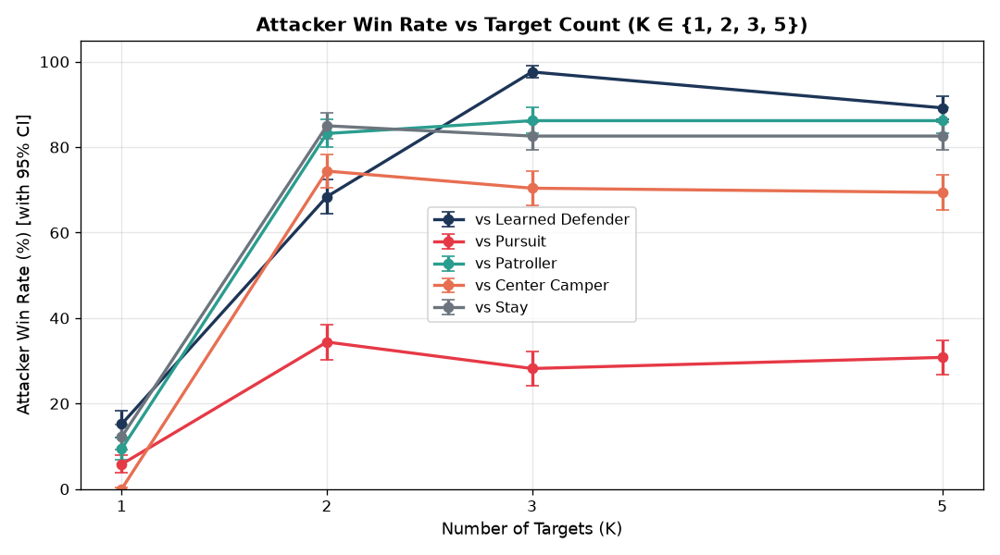

# Red Queen AI Arena

Red Queen AI Arena is a two-player reinforcement learning testbed. An attacker crosses one of three bridges to reach a target while a defender tries to intercept it. The project compares naive self-play with **Dual-Archive training**, where each agent also trains against saved policies from the opposing role.

The experiments measure bridge-route diversity, episode outcomes, and empirical exploitability against a fixed defender pool. Reducing catastrophic forgetting motivates the archive design. Route diversity is an indirect measure, and the exploitability results describe the tested pool of opponents.

[GitHub repository](https://github.com/Nava-deep-18/Red_queen) · [IEEE paper draft](docs/Research_Paper_final.pdf)
## Group members

Department of Mathematics, Sardar Vallabhbhai National Institute of Technology (SVNIT), Surat, India.

| Group member | SVNIT email | GitHub |
| --- | --- | --- |
| Navadeep Nindra | [u24mc006@amhd.svnit.ac.in](mailto:u24mc006@amhd.svnit.ac.in) | [@Nava-deep-18](https://github.com/Nava-deep-18) |
| Brij Radadiya | [u24mc005@amhd.svnit.ac.in](mailto:u24mc005@amhd.svnit.ac.in) | [@RadadiyaBrij](https://github.com/RadadiyaBrij) |
| Shrey Marakana | [u24mc009@amhd.svnit.ac.in](mailto:u24mc009@amhd.svnit.ac.in) | [@SHREY-RK](https://github.com/SHREY-RK) |
| Shree Pastagia | [u24mc011@amhd.svnit.ac.in](mailto:u24mc011@amhd.svnit.ac.in) | [@Shree-Pastagia](https://github.com/Shree-Pastagia) |

## Dataset resources

All training data comes from episodes generated by the simulator, using the arena rules and random starting positions. The repository includes these evaluation resources.

| Resource | What it contains |
| --- | --- |
| Original Citadel benchmark ([CSV](results/single_target/comparison_metrics.csv), [JSON](results/single_target/comparison_metrics.json)) | Results for the six-input Phase 4 attacker against learned and scripted defenders, with 500 episodes per matchup. |
| Configurable arena benchmark ([CSV](results/multi_target/comparison_metrics.csv), [JSON](results/multi_target/comparison_metrics.json)) | Breaches, captures, timeouts, and episode lengths for one, two, three, and five targets. Includes zero-shot transfer of the Citadel attacker against greedy pursuit. The JSON also contains bridge-entry and target-breach counts. |
| [Configurable training history](results/multi_target/training_history.json) | Saved rolling outcome rates from a two-target self-play run. |
| [Single-target evaluation report](docs/empirical_evidence_diversity_and_nash.md) | The recorded 150-seed route-diversity and restricted game-theoretic evaluation. |

Training produces policy checkpoints in `models/`. Training and the replay generator write episode trajectories to `replays/`. These directories are Git-ignored in this checkout. The benchmark files above can be read directly after cloning.

## Implementation environment

The environment checks were run on **Windows with Python 3.13.1**. Training and evaluation use PyTorch, NumPy, Gymnasium, PettingZoo, and Matplotlib. The scripts use CPU tensors by default. Streamlit and Plotly support the optional dashboard.

Run the commands from the repository root.

```sh
git clone https://github.com/Nava-deep-18/Red_queen.git
cd Red_queen
```

**Windows PowerShell**

```powershell
python -m venv .venv
.\.venv\Scripts\Activate.ps1
python -m pip install -r requirements.txt
```

**macOS or Linux shell**

```sh
python3 -m venv .venv
source .venv/bin/activate
python -m pip install -r requirements.txt
```

## Arena and training methods

The arena is an **11 × 7** grid. The river lies in column 5, with crossings at rows 1, 3, and 5. Both players move simultaneously. The attacker wins by reaching any active target, and the defender wins by intercepting the attacker. A breach takes priority if both occur on the same step. An undecided episode times out at the default 100-step horizon.

| Environment | Targets on column 10 | Policy inputs |
| --- | --- | --- |
| Original Citadel | Row 3 | 6 |
| Configurable arena | 1 target at row 3, 2 at rows 1 and 5, 3 at rows 1, 3, and 5, or 5 at rows 0, 1, 3, 5, and 6 | 19 |

The agents use **proximal policy optimization (PPO)** with separate actor and critic networks. Phase 3 trains an attacker against a stationary defender. Phase 4 trains both agents in naive self-play. Phase 6 keeps an archive for each role. After warm-up, 60% of training episodes use both current policies, 20% use the current attacker against a saved defender, and 20% use the current defender against a saved attacker. Saved opponents stay frozen during the matchup. The Phase 6 script starts saving policies after a 300-episode warm-up and adds a snapshot every 100 episodes. The configurable Dual-Archive script uses a 100-episode warm-up and saves every 50 episodes.

## Run the experiments

### Original Citadel

Train the three single-target configurations before running the route and exploitability evaluation. The separate 500-episode benchmark uses the Phase 4 checkpoints by default.

```sh
python src/train_phase3.py
python src/train_phase4.py
python src/train_phase6.py
python src/evaluate_bridge_diversity.py
python src/evaluate_single_target.py --episodes 500 --seed 42 --results-dir results/reruns/single_target
```

### Configurable arena

Train the Dual-Archive checkpoints for each preset before benchmarking them. The Phase 4 attacker from the previous section is used for the transfer rows.

```sh
python src/train_dual_archive_k2.py --k 1 --episodes 600
python src/train_dual_archive_k2.py --k 2 --episodes 600
python src/train_dual_archive_k2.py --k 3 --episodes 600
python src/train_dual_archive_k2.py --k 5 --episodes 600
python src/compare_single_vs_multi_target.py --targets 1 2 3 5 --episodes 500 --seed 42 --results-dir results/reruns/multi_target
```

The benchmark loads active checkpoints from `models/multi_target/`. For a separate naive self-play run, use `src/train_multi_target.py` with a different `--save-dir`. The evaluator's `--models-dir` flag selects which checkpoint directory to benchmark.

### Tests and replay viewer

```sh
python -m unittest discover -s tests -p test_multi_target_environment.py
python tests/test_pettingzoo_api.py
```

After training the two-target checkpoints, generate their replays with `python src/generate_k2_replays.py`. Start the optional dashboard with `python -m streamlit run src/dashboard.py`.

## Results at a glance

In the [recorded 150-seed single-target comparison](docs/empirical_evidence_diversity_and_nash.md), route entropy rose from **1.470** to **1.567 bits** and empirical exploitability against the tested pool fell from **0.160** to **0.140** with Dual-Archive training.

The tracked benchmark outputs use 500 episodes per matchup, starting seeds 42 through 541, and a 100-step horizon. The table shows each attacker's results against the learned defender trained with it.

| Saved matchup | Attacker win | Defender capture | Timeout |
| --- | ---: | ---: | ---: |
| Original Citadel, Phase 4 | 50.0% | 50.0% | 0.0% |
| Configurable, 1 target | 15.2% | 7.4% | 77.4% |
| Configurable, 2 targets | 68.4% | 31.6% | 0.0% |
| Configurable, 3 targets | 97.6% | 2.4% | 0.0% |
| Configurable, 5 targets | 89.2% | 10.8% | 0.0% |

The original Citadel and configurable one-target matchups share a target location. Their input sizes, training schedules, and checkpoints differ. On the three-target layout, the attacker won **97.6%** against its learned defender and **28.2%** against greedy pursuit. The records describe the saved checkpoints. Matched evaluation seeds help compare starting conditions, and training variation would require independent runs.



## Repository map

| Path | Purpose |
| --- | --- |
| [`src/environment.py`](src/environment.py) and [`src/multi_target_environment.py`](src/multi_target_environment.py) | PettingZoo arenas and reward shaping |
| [`src/agents/ppo.py`](src/agents/ppo.py) | PPO actor-critic implementation |
| [`src/`](src/) | Training, evaluation, and replay generation |
| [`results/`](results/) | Checked-in benchmarks and plots |
| [`docs/`](docs/) | Research paper drafts and project documentation |
| [`tests/`](tests/) | Environment and dashboard tests |
