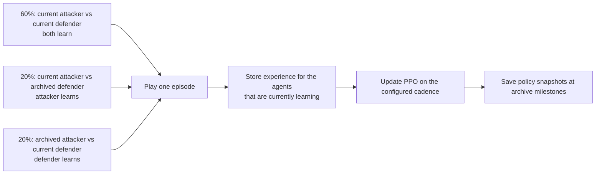
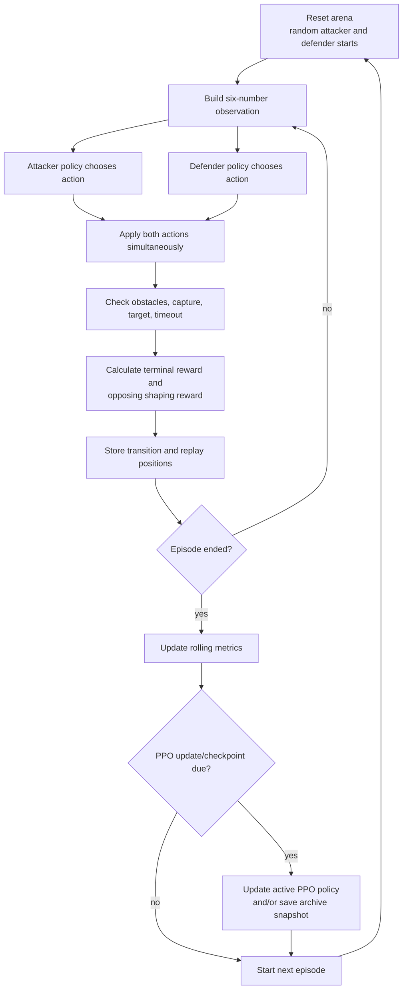

# Red Queen AI Arena: Beginner's Guide and Research Review

**Purpose:** Explain the project from first principles, describe what the current code actually does, and separate observations from research claims.  
**Code review date:** 14 October 2026.  
**Scope:** Documentation only. This file does not change the training code.

> Read this as a guide to a small computational experiment inspired by Red Queen dynamics. It is not evidence that a biological Red Queen hypothesis has been proved.

## 1. The basic question

Imagine two opponents whose choices affect each other's success. One tries to get through a guarded route; the other tries to stop it. If each opponent changes its strategy in response to the other, yesterday's good strategy may stop working. That ongoing adaptation is the idea this project wants to explore.

The project makes this idea into a small grid game:

- The **Attacker** tries to cross a river and reach a target.
- The **Defender** tries to intercept the Attacker before it reaches the target.
- Both can learn from trial and error using reinforcement learning.
- We compare a stationary opponent, direct self-play, and self-play with archived older policies.

The key questions are therefore computational ones: Do the agents adapt to each other? Do their strategies change over time? Does training against past opponents make an agent harder to exploit? Do measured results support a game-theoretic equilibrium claim?

The biological Red Queen hypothesis concerns reciprocal evolution of interacting organisms, often hosts and parasites. For example, laboratory coevolution work has compared current and archived host/pathogen populations over time. This grid simulation is an analogy for reciprocal adaptation; it does not model genes, populations, generations, or biological fitness. See [Schulte et al. on host–pathogen coevolution](https://pmc.ncbi.nlm.nih.gov/articles/PMC6338873/) and [Decaestecker et al. on archived host–parasite dynamics](https://www.nature.com/articles/nature06291).

## 2. Reinforcement learning in plain language

Reinforcement learning (RL) is a way to teach a decision-maker through repeated interaction rather than by giving it a complete list of correct answers.

One interaction is:

1. The environment shows the current **state** (the positions of the two players and the target).
2. Each agent chooses an **action** (move up, down, left, right, or stay).
3. The environment applies the moves and calculates **rewards**.
4. The agents use the experience to adjust their policies, meaning their rules for choosing actions.

An **episode** is one complete game, from spawn until capture, target arrival, or the step limit. Training runs many episodes. The learning algorithm tries to increase the long-term reward of the policy it is training.

### Important terms

| Term | Plain meaning in this project |
| --- | --- |
| State / observation | A six-number description of attacker, defender, and target coordinates. |
| Action | One of five moves. |
| Reward | A numeric score after a move or terminal event. Positive is good for the receiving agent; negative is bad. |
| Policy | The agent's learned rule for selecting actions from a state. |
| Self-play | Both sides use learned policies and train while playing one another. |
| Non-stationarity | From one learner's perspective, the opponent's behavior changes as that opponent learns. |
| Archive | Saved older policy weights that can be selected as opponents in later episodes. |
| Win rate | Fraction of episodes won under a specified evaluation setup. A win rate depends on which opponents and starting states were used. |
| Nash equilibrium | A strategy profile where neither side can improve its expected payoff by changing strategy alone. Balanced scores do not establish this. |
| Exploitability | How much a best-response opponent can improve its outcome against a proposed strategy or mixture. Lower is better for an equilibrium claim. |

## 3. The arena and its rules

The environment is implemented in [`src/environment.py`](../src/environment.py).

### Map

- The board is **11 columns by 7 rows**. Coordinates run from `x=0..10` and `y=0..6`.
- The river is the column `x=5`.
- River cells at rows `y=0,2,4,6` are blocked.
- The three open crossings are at `(5,1)`, `(5,3)`, and `(5,5)`.
- The target is fixed at `(10,3)`.
- The Attacker starts at a random location with `x=0..3`.
- The Defender starts at a random location with `x=6..7`.
- The players cannot start on the blocked cells or on top of each other. The target does not currently move.

The map is meant to create several possible routes, not to establish that the game mathematically has a rock-paper-scissors payoff structure. That needs to be demonstrated from the actual rules and measured outcomes.

### Actions and turns

Both players have the same five actions: `UP`, `DOWN`, `LEFT`, `RIGHT`, and `STAY`. The code obtains both actions and then applies them in the same environment step. A move outside the board or into an obstacle leaves that player in place.

The current state is:

```text
[attacker_x, attacker_y, defender_x, defender_y, target_x, target_y]
```

Each coordinate is normalized to the range `[0,1]`: x coordinates are divided by 10 and y coordinates by 6. Both agents receive the same global state, so this is a fully observable game in the present implementation.

### Ending and scoring

- If the Attacker reaches the target, the Attacker wins.
- If the players end on the same cell, the Defender catches the Attacker.
- Swapping cells in the same step also counts as a catch.
- Reaching the target has priority over capture if both flags would otherwise apply.
- If neither event happens within **75 steps**, the episode is truncated and counted as a timeout/draw.
- Terminal rewards are `(+10,-10)` for an Attacker win, `(-10,+10)` for a Defender win, and `(0,0)` for a timeout.

Being adjacent does not itself count as a capture. Capture requires the same final cell or a crossing swap. Because both players move simultaneously, an Attacker next to the Defender can move away in the same step.

### A note on the environment API

The code inherits from `gymnasium.Env` and uses Gymnasium spaces and the current `reset()` return convention. However, its `step()` takes **two simultaneous actions** and returns **two rewards**. That is not the standard single-agent Gymnasium `Env.step(action)` interface. It is a custom two-player interface with parallel-action semantics. For interoperability with multi-agent tooling, a formal [PettingZoo Parallel API](https://pettingzoo.farama.org/api/parallel/) implementation would be a better fit: simultaneous actions, observations, rewards, terminations, truncations, and infos represented per agent. The current training scripts work with the custom interface because they call it directly.

## 4. What “strict zero-sum” means here

In a zero-sum game, one player's reward is always the negative of the other's. If the Attacker's reward is `r`, the Defender's reward is `-r`; therefore the two rewards sum to zero.

The environment's terminal rewards follow this rule. The current Phase 4 and Phase 6 training code also calculates a distance-based shaping value `F` and adds it symmetrically:

```text
attacker training reward = environment attacker reward + F
defender training reward = environment defender reward - F
```

So the **implemented rewards remain zero-sum at each transition**, assuming the same `F` is used on both sides. This is the right correction to the previous one-sided shaping. The environment helper is `compute_zero_sum_shaping()`.

There are two qualifications:

1. **Phase 3 has an extra attacker-only proximity penalty.** It is a fixed-opponent baseline, not the symmetric two-learning-agent zero-sum experiment.
2. **Zero-sum reward accounting and policy-invariant shaping are different claims.** Standard potential-based shaping uses a discounted potential difference such as `F(s,s') = gamma * Phi(s') - Phi(s)`. The helper currently uses a plain distance difference, while PPO uses `gamma=0.99`. Opposing `+F/-F` preserves zero-sum reward accounting, but the current formula does not automatically justify the stronger claim that all original optimal policies/equilibria are unchanged. Either use the theorem's matching formula and terminal handling, or state only the verified zero-sum accounting property.

The Phase 4 source comments and console messages still describe that run as **general-sum with attacker-only shaping**, even though the current reward code has been changed to symmetric shaping. Those comments are stale and should be corrected. The README and game spec also need to be checked against the exact shaping formula before they claim theoretical policy invariance.

## 5. How learning is implemented

The main algorithm is PPO, implemented in [`src/agents/ppo.py`](../src/agents/ppo.py). In simple terms, PPO:

1. Uses an **actor** neural network to produce probabilities for the five actions.
2. Samples an action during training, so the same state can produce different actions on different visits.
3. Uses a **critic** neural network to estimate how valuable a state is.
4. Collects states, selected actions, log probabilities, rewards, and episode-ending flags.
5. Updates the actor and critic using a clipped policy-gradient objective, then copies the updated weights to the old policy used for the next rollout.

The present implementation calculates discounted Monte Carlo returns. It does **not** implement Generalized Advantage Estimation (GAE), despite the README currently saying it does. The `DQNAgent` is also present in [`src/agents/dqn.py`](../src/agents/dqn.py), but no current training script uses it; it is an unused alternative, not part of the reported results.

Stochastic training actions explain why a Defender may sometimes choose `STAY` repeatedly. That is not automatically a software freeze; it may be the sampled action or the learned action probability. If a run should be evaluated as a probability mixture, sample from the policy. Greedy `argmax` evaluation answers a different question: what does the most-probable-action version do?

## 6. Project stages: why the numbering skips

The phase numbers are project labels, not steps required by Red Queen theory. The repository currently has scripts for Phase 3, Phase 4, Phase 6, and a Phase 7 evaluation script; it does not have a Phase 5 training script. Earlier phases are represented partly by the design document. Explain the missing number or renumber the public-facing stages.

### Phase 3 — fixed-opponent baseline

[`src/train_phase3.py`](../src/train_phase3.py) trains the Attacker against a Defender that always stays still. This checks whether the Attacker can learn basic navigation and creates a baseline for later work. It is not co-adaptation because the opponent does not learn. The code also adds a danger penalty to the Attacker's reward, so this baseline should not be described as the same strictly zero-sum learning objective as Phases 4 and 6.

### Phase 4 — simultaneous self-play

[`src/train_phase4.py`](../src/train_phase4.py) trains both agents using PPO. They play against each other, and both collect experience. The code updates the PPO agents every 20 episodes and records rolling win rates. It produces a replay and a curve.

This is the experiment most directly related to the computational Red Queen analogy: as one policy changes, the opponent it faces also changes. However, a fluctuating win-rate plot alone does not show which strategy changed, whether there was a repeatable cycle, or whether a learner forgot an earlier counter-strategy.

Current README/source mismatches: README says 2,500 episodes; the script uses 2,000. Phase 4 source comments still claim attacker-only shaping/general-sum, whereas the code now uses opposing shaping rewards.

### Phase 6 — self-play with policy archives

[`src/train_phase6.py`](../src/train_phase6.py) keeps current attacker and defender policies and saves older snapshots. After a warmup, each episode selects one of these matchups:



The current code samples uniformly from saved archive entries. It saves snapshots to disk and keeps them in memory during the run. It does **not** weight snapshots by a computed Nash mixture. Archives begin being sampled only after the first qualifying checkpoint: with `warmup_episodes=500` and `archive_interval=150`, the first checkpoint is episode 600.

Phase 6 now updates on a 20-episode cadence rather than the previous 2,000-episode mistake and plots attacker wins, defender wins, and timeouts. This is progress, but its win-rate calculation is conditional: attacker wins are added to the attacker's rolling window only in episodes where the current Attacker is training; defender wins only when the current Defender is training. Each rate is then repeated on the graph for episodes where that agent was not being trained. The two curves therefore do not represent a clean, common evaluation set and they mix different opponent matchups. Use a separate fixed evaluation schedule for the main comparison.

The archive is currently **unbounded**, not rolling: snapshots are appended and saved; old snapshots are not dropped. That avoids the specific risk of old opponents aging out, but uniform sampling can still spend too little probability on strategically important policies.

### Phase 7 — robustness evaluation

[`src/evaluate_robustness.py`](../src/evaluate_robustness.py) compares Phase 4 and Phase 6 Attacker checkpoints against four scripted Defenders. It uses 100 common environment seeds per archetype and greedy attacker actions, and reports approximate confidence intervals.

This is a useful secondary test of performance against those scripts. It is not an equilibrium test, because it does not compute best responses or evaluate a population of learned strategies. Greedy actions are useful for a deterministic deployment-style comparison, but a stochastic-policy analysis should also sample from the learned action distributions. Report both if both questions matter.

### Dashboard and replays

[`src/dashboard.py`](../src/dashboard.py) displays saved plots, text, and replay files. It does not retrain models. A new training run is required to create new replay/model outputs. The 3D viewer in [`dashboard_3d.html`](../dashboard_3d.html) visualizes saved paths; it is not itself evidence that a policy is effective.

## 7. How a training run flows



## 8. What the existing plots can and cannot say

### Rolling windows and noise

The curves use rolling windows (typically 100 episodes). If a win rate is near 0.5 with 100 independent Bernoulli trials, the simple standard error is about `sqrt(0.5 * 0.5 / 100) = 0.05`. A rough 95% range is about ±0.10. This helps explain why movement from 0.4 to 0.6 in one window may be ordinary sampling noise.

But adjacent rolling windows share 99 of their 100 episodes, so adjacent plotted points are strongly dependent. Training episodes are also non-identically distributed because policies change over time. Do not use the simple standard error as a formal confidence interval for a curve. Use independent training seeds, fixed evaluation batches, and uncertainty calculations that respect the grouping/time dependence. Large swings may be worth investigating, but they are not proof of a cycle.

### Wins and timeouts must be exclusive

For every episode, exactly one outcome should be recorded: attacker win, defender win, or timeout. Then:

```text
attacker_win + defender_win + timeout == 1
```

The current environment gives target arrival priority over capture, and Phase 4/6 count mutually exclusive wins. That fixes the earlier double-win metric issue. One small edge remains: `info["timeout"]` is based on reaching the step limit even if a win happens on that same last step, while `truncated` is correctly false for a terminal win. For outcome accounting, derive timeout from `truncated` (or make the info flag mutually exclusive) and assert the invariant per episode. Phases 4 should also plot timeout/draw frequency if the win-rate denominator includes all episodes.

### Phase 6 mixes training matchups

Once archives are active, the training population includes current-vs-current and two current-vs-archived cases. The Phase 6 plot is a training diagnostic, not a fair head-to-head measurement of the current policies. Add a separate evaluation loop that freezes the current policies and uses the same starts/opponent set for both sides and every checkpoint.

### Balance is not equilibrium

Attacker and Defender win rates both near 0.5 do not prove equilibrium. A pair of policies can split wins evenly and still be exploitable by a third policy. A low timeout rate only says episodes usually end before the step limit; it does not show strategic robustness.

## 9. What evidence would support an equilibrium claim?

For this finite grid, a practical empirical game-theoretic analysis can be built around a population of saved policies:

1. **Define the payoff precisely.** Use one fixed zero-sum return definition and state how timeout draws count. Ensure terminal outcomes are exclusive.
2. **Collect policy snapshots.** Save checkpoints from both sides at planned points in every independent training run.
3. **Cross-play policies.** Run each saved Attacker against each saved Defender on matched start seeds. Store the mean payoff and uncertainty for every cell of the payoff matrix.
4. **Compute a mixture.** Solve the finite zero-sum matrix game for approximate mixed strategies over the policy population.
5. **Measure exploitability.** Calculate best-response gains against the proposed mixtures, or train approximate best-response agents against them. Report how the exploitability gap changes as training proceeds.
6. **Check robustness.** Evaluate against held-out starts and additional opponents. Keep the four hand-coded archetypes as a secondary generalization result.
7. **Repeat training.** Run multiple independent seeds; show mean and confidence bands. Five seeds are a useful minimum for an initial exploratory comparison, not a guarantee of adequate statistical power.

If `A[i,j]` is the mean Attacker payoff when Attacker policy `i` faces Defender policy `j`, and `p` and `q` are proposed mixtures over those populations, the mixture's payoff is `pᵀAq`. The Attacker's best-response gain is `max_i (Aq)_i - pᵀAq`; the Defender's is `pᵀAq - min_j (pᵀA)_j`. A low sum of these gains is evidence that neither side can gain much by switching to a policy in the tested population. It is still an **empirical, population-limited** result: stronger policies outside the population may exploit it.

This population-and-payoff approach is in the spirit of [Policy-Space Response Oracles](https://arxiv.org/abs/1711.00832), which explicitly studies mixtures and responses across policy populations. The current archive trainer is inspired by historical-opponent training, but it does not yet implement the full PSRO method or compute a Nash mixture.

## 10. What evidence would support a Red Queen cycle?

Win rates are outcomes; a cycle is a strategy pattern. The replay logs already contain player positions, so a first route analysis can derive:

- which bridge row (`1`, `3`, or `5`) the Attacker actually crossed on each episode;
- where the Defender was when that crossing occurred;
- rolling frequencies of each route and defensive position;
- whether changes in one side's route distribution are followed by counter-changes in the other side.

Then quantify periodicity with autocorrelation or a spectral analysis, compare against independent seeds, and inspect whether the pattern repeats rather than appearing in one noisy run. A strategy cycle should be described as observed only if the policy/route data show a repeatable, temporally linked cycle.

## 11. Mistakes and gaps: current status

This table revisits the 12 review points supplied by the project owner and checks them against the current code on 14 October 2026.

| # | Concern | Current status and what remains |
| --- | --- | --- |
| 1 | No equilibrium evidence yet | **Pending.** No policy cross-play payoff matrix or exploitability/best-response calculation exists. Current curves are not equilibrium evidence. |
| 2 | Phase 6 oscillations may be noise | **Pending.** No multi-seed confidence bands or oscillation statistic. The 100-episode binomial standard-error calculation is only a rough intuition because training changes over time and rolling windows overlap. |
| 3 | Attacker + Defender + timeout accounting | **Mostly fixed; edge remains.** Win flags are mutually exclusive, but `info["timeout"]` can also be true when a win lands exactly on the step limit. Use `truncated` for timeout accounting and assert one outcome per episode. |
| 4 | Phase 6 mixes opponents | **Pending.** Training curves conditionally count only episodes where that current agent is learning, and those include different matchup types. Add a separate fixed evaluation set for both current policies. |
| 5 | Single training seed / fixed starts | **Partly resolved.** Attacker and Defender starts are randomized and seedable; target remains fixed by design. Training scripts do not establish a multi-seed study or seed all Python/NumPy/PyTorch randomness. Use multiple independent training seeds and held-out starts. |
| 6 | Greedy Phase 7 evaluation | **Partly resolved by explicit scope.** Greedy evaluation is appropriate for a deterministic-policy benchmark, but not a substitute for evaluating the stochastic mixtures used in equilibrium analysis. Report both when relevant. |
| 7 | Phase 7 is not equilibrium testing | **Still true.** Four hand-coded defenders test specific scripted generalization. Keep this secondary; add learned populations and exploitability as the primary equilibrium test. |
| 8 | Unequal shaping / sparse defender reward | **Fixed for Phases 4 and 6 at the reward-sum level.** Both receive opposing shaping. Phase 3 still has attacker-only danger penalty. Phase 4 comments and console text are stale. The shaping theorem's discounted-potential condition also needs checking. |
| 9 | Red Queen cycle not measured | **Pending.** Replays contain positions from which crossing rows can be derived, but the project does not yet plot route frequencies or measure cycling/autocorrelation. |
| 10 | Forgetting not measured | **Pending.** Archives exist, but no cross-play heatmap/old-opponent retention metric compares current policies against historical opponents over time. |
| 11 | Archive can drop old snapshots / uniform selection | **Dropping is not currently happening.** The in-memory and disk archives grow; there is no rolling eviction. Uniform sampling remains and is not a Nash-weighted mixture. Consider a deliberate policy-selection rule and report it. |
| 12 | Phase numbering and absolute links | **Pending.** There is no Phase 5 training script, and README links still use `file:///c:/...` paths that will not work for GitHub readers. Some README facts also disagree with code: episode counts, 75 vs 100 step cap, GAE, and API claims. |

### Additional code/documentation gaps found

- **Gymnasium/PettingZoo claim:** `ArenaEnv` is not a standard single-agent Gymnasium environment because it accepts two actions and returns a reward pair. It is also not yet a formal PettingZoo Parallel environment. Call it a custom parallel-action environment, or implement a standard multi-agent API.
- **PPO README mismatch:** the implemented PPO uses discounted Monte Carlo returns; it does not contain GAE.
- **Potential-shaping claim:** symmetric opposing shaping proves reward sums are zero, but the current plain difference omits the PPO discount factor in the standard potential-shaping expression. Policy/equilibrium invariance should not be claimed until aligned and validated.
- **Stochastic vs greedy behavior:** PPO samples during training and `predict()` takes argmax. The evaluation method must match the scientific question and be stated beside every result.
- **One run is not robust evidence:** training scripts save one final model each. Paired seeds in Phase 7 control evaluation starts for the two fixed models; they do not replace repeated independent training runs.
- **Stale marketing text:** dashboard “Real-World” examples sometimes say archive training makes policies impossible to exploit or “solves” a domain problem. This grid simulation cannot support those claims. Present them as analogies or remove them.
- **README links and implementation details:** README still has machine-local `file:///c:/Red_queen/...` links and claims that conflict with current files. Use relative Markdown links and re-check run counts, timeout, phases, environment API, and algorithms against source.

## 12. Suggested order of work

1. Reconcile README, Phase 4 comments, dashboard claims, and game spec with the current implementation.
2. Fix timeout accounting and add an episode-outcome invariant check.
3. Confirm the intended shaping theorem/formula; keep the strict zero-sum reward check separate from the policy-invariance claim.
4. Build a frozen, common evaluation set and report training-vs-evaluation metrics separately.
5. Run several independent training seeds and report uncertainty.
6. Derive bridge-route frequencies from replays and test for repeatable cycles.
7. Create policy cross-play payoff matrices and compute empirical best-response exploitability.
8. Only then decide whether the evidence supports wording such as “near-equilibrium” or “Red Queen-like strategic cycling.”

## 13. Source map and how to run

| File | Role |
| --- | --- |
| [`src/environment.py`](../src/environment.py) | Arena rules, state, actions, terminal outcomes, zero-sum shaping helper. |
| [`src/agents/ppo.py`](../src/agents/ppo.py) | Actor-critic PPO implementation used by training scripts. |
| [`src/agents/dqn.py`](../src/agents/dqn.py) | DQN implementation; currently not used by the phase scripts. |
| [`src/train_phase3.py`](../src/train_phase3.py) | Attacker vs stationary Defender baseline. |
| [`src/train_phase4.py`](../src/train_phase4.py) | Both current policies train in self-play. |
| [`src/train_phase6.py`](../src/train_phase6.py) | Current/archived opponent matchup training. |
| [`src/evaluate_robustness.py`](../src/evaluate_robustness.py) | Greedy attacker comparison against scripted defender archetypes. |
| [`src/replay_logger.py`](../src/replay_logger.py) | Writes replay trajectories to JSON. |
| [`src/dashboard.py`](../src/dashboard.py) | Displays static plots, replay data, and project descriptions. |
| [`dashboard_3d.html`](../dashboard_3d.html) | 3D replay visualization. |
| [`docs/TO_DO_NEXT.md`](TO_DO_NEXT.md) | Roadmap; some items are now stale and should be reconciled. |

From the repository root, with the virtual environment installed:

```powershell
\.venv\Scripts\python.exe src\train_phase3.py
\.venv\Scripts\python.exe src\train_phase4.py
\.venv\Scripts\python.exe src\train_phase6.py
\.venv\Scripts\python.exe src\evaluate_robustness.py
\.venv\Scripts\python.exe -m streamlit run src\dashboard.py
```

Training overwrites the corresponding replay/model/plot outputs. The dashboard reads saved outputs; it does not train the agents. Keep backups if you need to preserve earlier runs.

## 14. A concise, defensible project description

> This project implements a small, fully observable, simultaneous-action grid game and compares a fixed-opponent Attacker baseline, PPO self-play, and self-play trained against archived policies. Phases 4 and 6 use opposing potential-shaped rewards so the per-step rewards sum to zero. Current plots are descriptive training diagnostics; fixed-archetype evaluation measures performance against those scripts. The project has not yet measured policy-population exploitability, so it does not establish Nash-equilibrium convergence. Replay-based route analysis and repeated training seeds are needed to substantiate Red Queen-like strategic cycling and archive-related retention claims.

