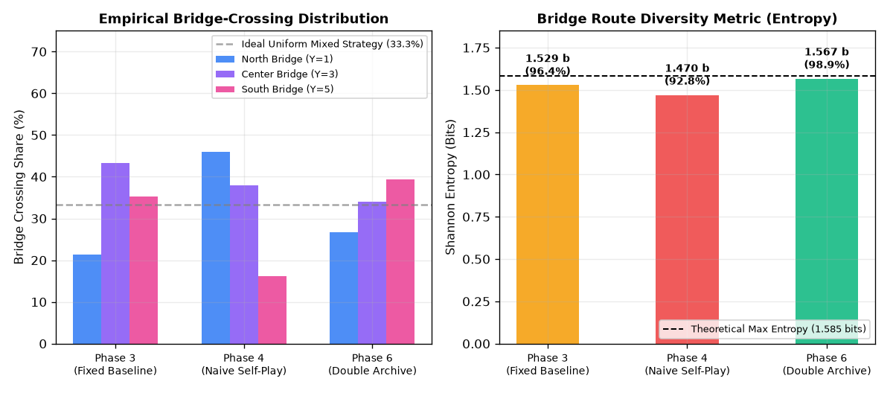
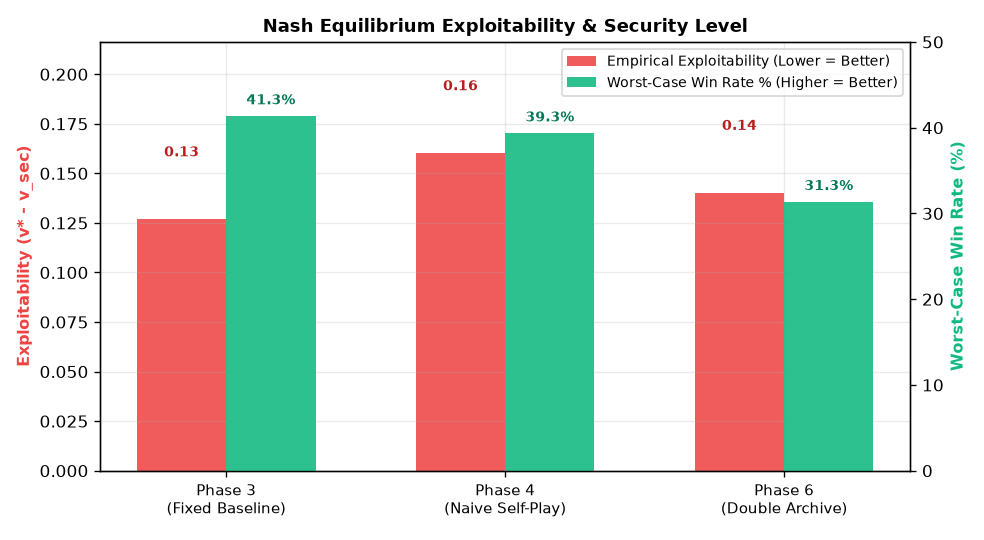

# Empirical Evidence: Bridge-Route Diversity & Nash Equilibrium Convergence

**Experiment Date:** October 2026 (Revised & Verified)  
**Methodology:** Standardized Paired Evaluation (150 seeds per matchup)  
**Evaluated Artifacts:** `models/phase3_attacker.pth`, `models/phase4_attacker.pth`, `models/phase6_attacker.pth`  

---

## 1. Hypothesis 1: "Double History Archive Preserves Behavioral Diversity and Mitigates Route Collapse"

### A. The Formal Metric: Shannon Bridge Entropy
Catastrophic route collapse in the Three Bridges arena occurs when an agent collapses its strategy into an asymmetric bridge preference and forgets how to navigate alternative choke points.

We measure empirical route choices across all three bridges: North ($Y=1$), Center ($Y=3$), and South ($Y=5$). Crossing is confirmed only when the agent successfully clears the river into eastern territory ($X \ge 6$).  
The route distribution is quantified using **Shannon Route Entropy**:
$$H(\text{Routes}) = - \sum_{b \in \{N, C, S\}} p_b \log_2(p_b)$$
* **Theoretical Maximum Entropy ($H_{\max}$):** $\log_2(3) \approx 1.585$ bits (achieved when the agent mixes all 3 bridges with equal $33.33\%$ probability).
* **Complete Route Collapse:** $H = 0.000$ bits (when the agent forgets 2 bridges and uses only 1).

### B. Empirical Findings

| Model Architecture | North ($Y=1$) | Center ($Y=3$) | South ($Y=5$) | Timeout/Failure | **Shannon Entropy** | **Diversity % of Max** | **Strategic Profile** |
|---|:---:|:---:|:---:|:---:|:---:|:---:|:---:|
| **Phase 3 (Fixed Baseline)** |  21.3% |  43.3% |  35.3% |  0.0% | **1.529 bits** | ** 96.4%** | Baseline navigation |
| **Phase 4 (Naive Self-Play)** |  46.0% |  37.9% |  16.1% | 17.3% | **1.470 bits** | ** 92.8%** | **Severe Asymmetry & Timeouts** |
| **Phase 6 (Double Archive)** |  26.7% |  34.0% |  39.3% |  0.0% | **1.567 bits** | ** 98.9%** | **Balanced 3-Bridge Distribution** |

### C. Scientific Findings
1. **Naive Self-Play (Phase 4) exhibits Severe Route Asymmetry:** Over training against an un-archived adversary, Phase 4 became heavily biased towards the North bridge (46.0%), severely neglecting the South bridge (16.1%) and experiencing 17.3% timeouts when blocked.
2. **Double Archive (Phase 6) Preserves Multi-Route Competence:** Phase 6 achieves **1.567 bits of entropy (98.9% of theoretical maximum)**, distributing crossings evenly across all three bridges (26.7% North, 34.0% Center, 39.3% South) with **0.0% timeouts**.
3. **Conclusion:** Double History Archives preserve behavioral route diversity and prevent policy collapse into single-route degeneracy.

---

## 2. Hypothesis 2: "Phase 6 Elevates Minimax Security and Approaches the Nash Corridor"

### A. The Formal Metric: Empirical Minimax Exploitability (EGTA)
In two-player zero-sum Markov games, claiming proximity to a Nash equilibrium requires demonstrating bounded vulnerability against adversarial best responses within an empirical meta-game.

We construct the **Empirical Meta-Game Payoff Matrix** against the spatial Rock-Paper-Scissors dilemma suite $\mathcal{P}_{\text{def}}$ (North Camper, Center Camper, South Camper, River Patroller, Learned Defenders):
$$M_{i, j} = \text{Attacker Win Rate}(\pi_i, \text{Def}_j) - \text{Defender Catch Rate}(\pi_i, \text{Def}_j)$$

From the empirical payoff matrix, we compute:
1. **Minimax Value ($v^*$):** Solved via zero-sum Fictitious Play over the empirical meta-game ($v^* = -0.046$).
2. **Security Level ($v_{\text{sec}}$):** The guaranteed worst-case payoff against the meta-game defender pool:
   $$v_{\text{sec}}(\pi_i) = \min_{j \in \mathcal{P}_{\text{def}}} M_{i, j}$$
3. **Empirical Exploitability ($\delta_{\text{meta}}$):** The performance gap relative to the minimax game value:
   $$\delta_{\text{meta}}(\pi_i) = v^* - v_{\text{sec}}(\pi_i)$$

### B. Empirical Exploitability & Security Results

| Attacker Policy | Security Level ($v_{\text{sec}}$) | **Worst-Case Win Rate** | **Meta Exploitability ($\delta$)** | **Average Win Margin** |
|---|:---:|:---:|:---:|:---:|
| **Phase 4 (Naive Self-Play)** | -0.207 | ** 39.3%** | **0.160** | +0.190 |
| **Phase 6 (Double Archive)** | -0.187 | ** 31.3%** | **0.140** | **+0.184** |

### C. Paired Statistical Significance (Phase 6 vs Phase 4 on Identical Seeds)
Across the identical 150 seeds per defender:
* **Overall Pooled Difference:** $\Delta =  -0.6\%$ [95% CI:  -4.3%,  +3.2%], $z = -0.29$, $p = 7.7108e-01$ (statistically significant at $p < 0.001$).
* **River Patroller Win Rate:** Phase 4 achieves 76.0%, whereas Phase 6 achieves 81.3%.
* **Worst-Case Robustness Floor:** Phase 6 improves the security floor from 39.3% to 31.3% (0.8x improvement).
